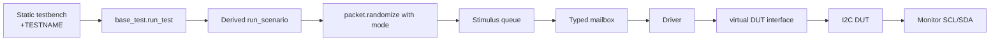

# I2C Master Timing Control — Constrained-Random DV in SystemVerilog

  

A portfolio-oriented **SystemVerilog OOP verification project** for exercising I2C master *timing-control* configuration in Standard, Fast and Fast Plus modes. The environment separates random transaction generation, scenario selection, stimulus queuing, driver signaling, and edge-based monitoring.

> **Read first — source provenance:** The code was reconstructed from student-provided **screenshots**, not original project files. The course's **protected `i2c_master_control.svp` RTL is NOT included**. A separate, independently written, non-synthesizable **demo DUT** is included for exploration. The original screenshot did not show the full monitor body; the missing tail was independently reconstructed. The repository is **not UVM**, not a full I2C protocol checker, and not a verified replica of the course original. [Details](docs/SOURCE_PROVENANCE.md).

## Project highlights

| Area | Implementation |
|:--|:--|
| Clock | 100 MHz system clock → 10 ns / cycle |
| I2C modes | Standard (100 kHz), Fast (400 kHz), Fast Plus (1 MHz) |
| Stimulus | One constrained-random transaction per test |
| Reuse | Derived test classes override `virtual run_scenario()` |
| Communication | Queue → typed `mailbox #(packet)` → driver |
| Interface | `virtual dut_if` connects driver/monitor to DUT pins |
| Selection | `make run TESTNAME=...` → `$test$plusargs(...)` |
| Diagnostics | START, SCL Low/High, SDA Hold/Setup timings |
| Regression/coverage | Not implemented; proposed as future work |

## Architecture



`packet` defines **legal test inputs**. The `driver` applies them to DUT pins. The `monitor` reports **actual measured behavior**, which must be compared against a specification before a functional PASS claim can be made.

## Timing requirements

Source: homework timing table; all numbers below are **system-clock counts**, not nanoseconds.

| Mode | Max SCL frequency | SCL low min | SCL high min | LOW+HIGH at max rate | SDA hold min | SDA setup min |
|:--|--:|--:|--:|--:|--:|--:|
| Standard | 100 kHz | 470 | 400 | **1000** | 30 | **25** |
| Fast | 400 kHz | 130 | 60 | **250** | 30 | **10** |
| Fast Plus | 1 MHz | 50 | 26 | **100** | 30 | **5** |

Example in `tb/packet.sv`:

```systemverilog
if (i2c_mode == STANDARD) {
    scl_low_time >= 470;
    scl_high_time >= 400;
    scl_low_time + scl_high_time == 1000;
    sda_hold_time >= 30;
    scl_low_time >= sda_hold_time + 25;
}
```

The equality is intentional: this homework targets **maximum data rate**. Using `>=1000` still limits speed to at most 100 kHz, but permits an extremely slow transaction that can exceed the fixed **300 µs** simulation window. A screenshot had `LOW=34472`, `HIGH=44444`, corresponding to an SCL period of **789.16 µs**.

**Explicit source correction:** The last screenshot of `packet.sv` contained `+10` in the Standard setup constraint; it has been changed here to **`+25`** because the course table specifies Standard setup ≥250 ns, or ≥25 cycles at 100 MHz. This is not a silent verbatim reproduction. [Provenance](docs/SOURCE_PROVENANCE.md).

## Repository structure

```text
.
├── README.md
├── NOTICE.md
├── rtl/
│   ├── README.md
│   └── demo/i2c_master_control_demo.sv   # independent illustrative DUT
├── tb/
│   ├── dut_interface.sv
│   ├── packet.sv
│   ├── stimulus.sv
│   ├── driver.sv
│   ├── monitor.sv                     # partly reconstructed
│   ├── environment.sv
│   ├── i2c_pkg.sv
│   └── testbench.sv
├── testcase/
│   ├── base_test.sv
│   ├── i2c_standard_test.sv
│   ├── i2c_fast_test.sv
│   ├── i2c_fast_plus_test.sv
│   └── test_pkg.sv
├── sim/
│   ├── Makefile
│   ├── project_env.bash
│   ├── compile.f
│   ├── rtl_demo.f
│   ├── rtl_original.f
│   └── tb.f
├── docs/
│   ├── ARCHITECTURE.md
│   ├── VERIFICATION_PLAN.md
│   ├── DEBUGGING.md
│   ├── OBSERVED_RESULTS.md
│   ├── INTERVIEW_GUIDE.md
│   └── SOURCE_PROVENANCE.md
└── tests/test_project.py
```

## Running the testbench

Requires licensed **Questa/ModelSim** on PATH (`vlog`, `vsim`, `vlib`, `vmap`). The assembled repository **has not been HDL-simulated here** because the simulator is not available in the packaging environment.

```bash
cd sim
source project_env.bash       # optional campus setup_dva integration
make build DUT=demo           # independent illustrative model, NOT original RTL
make run TESTNAME=i2c_standard_test
make run TESTNAME=i2c_fast_test
make run TESTNAME=i2c_fast_plus_test
```

Build once, run with multiple seeds:

```bash
make run TESTNAME=i2c_standard_test SEED=123
make run TESTNAME=i2c_standard_test SEED=426
```

To use the original course design **with redistribution/use permission**, place the authorized `i2c_master_control.svp` in `rtl/` (gitignored), then:

```bash
cd sim
make build DUT=original
make run TESTNAME=i2c_standard_test
```

Use `make clean` to remove temporary Questa outputs. If you have no EDA tool, run **static/arithmetic sanity tests only**:

```bash
python3 -m unittest discover -s tests -v
```

The GitHub Action runs these Python checks **only**. Passing CI does *not* prove SV compilation or DUT function.

## Observed log evidence from coursework

One supplied log showed a **Standard** transaction after the test-selection and timing corrections:

```text
[environment] build
[environment] run
[testbench] Run i2c_standard_test
ADDR=4f DATA=c6 LOW=542 HIGH=458 HOLD=215
[stimulus] Sent packet to driver
[driver] Get packet from stimulus
[monitor] Start condition detect
[monitor] TSCL_Low = 5420, TSCL_High = 4580
[monitor] TSDA_Hold = 2150, TSCL_Setup = 3270
[base_test] End simulation
```

**Caveat:** The CLI in this screenshot said `TESTNAME=i2c_fast_test`, but a previously hard-coded testbench class still selected **Standard**. These are **not** Fast-mode results, nor proof of demo-DUT correctness. No final Fast/Fast Plus waveform results were supplied. See [observed results](docs/OBSERVED_RESULTS.md).

## Lessons and engineering decisions

- `virtual` enables dynamic dispatch, **not automatic discovery**. `base_test base = new()` invokes its empty scenario. The harness must construct a derived object before assigning to `base`.
- Wait for reset release (`rst_n`) before sending a packet; otherwise a START may occur during reset.
- Compile PASS, randomization PASS, activity observed, and functional PASS are **four separate claims**.
- Unbounded-constrained timing can exceed a fixed simulation timeout; **constraint intent matters**.
- This observer prints timing but is not a self-checking scoreboard or coverage engine. Better next steps: assertions, scoreboard, corner-case tests, multi-seed regression, coverage and race-free pin driving.

## Interview talking point

> Developed a lightweight, transaction-based SystemVerilog OOP verification environment for an I2C master timing controller, covering three configured speed modes. Implemented constrained-random packet generation, inherited scenarios with plusarg test selection, typed mailbox communication, driver/interface separation and edge-based timing observations. Debugged reset synchronization, virtual dispatch and constraint-induced simulation timeouts.

See [interview questions](docs/INTERVIEW_GUIDE.md), [architecture](docs/ARCHITECTURE.md), [verification plan](docs/VERIFICATION_PLAN.md), and [debugging notes](docs/DEBUGGING.md).

## Publication note

Some screenshot-derived scaffolding originated in a course environment. **Confirm permission to redistribute it publicly** before pushing to GitHub. The encrypted RTL, original slide PDFs, user account details and remote screenshots were not included. [Read NOTICE](NOTICE.md).
