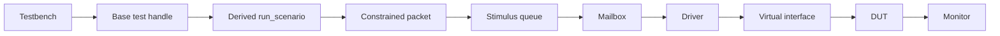

# Verification architecture

This is a lightweight, non-UVM SystemVerilog OOP environment.

| Block | Responsibility |
|---|---|
| `packet` | Carries address, data, mode, and timing counts with constraints. |
| `base_test` | Common `build`, `send_pkt`, `run_test`, virtual extension hook. |
| Derived tests | Create one packet, force chosen mode with `randomize() with`, send it. |
| `test_pkg` | Registers test class declarations at compile time. |
| `testbench` | Connects DUT, generates clock/reset, uses `$test$plusargs` to pick the real derived object. |
| `environment` | Constructs and connects class instances. |
| `stimulus` | Queues packets, publishes them to `mailbox #(packet)`. |
| `driver` | Converts packet to DUT pin activity via `virtual dut_if`. |
| `monitor` | Observes START and edge timing, prints reports. |

**Why virtual dispatch matters:** `run_test()` calls `run_scenario()` on a `base_test` handle. A `base_test` instance uses the empty base task; a handle referencing an `i2c_*_test` instance executes the derived scenario. The class must actually be constructed; `virtual` alone does not trigger a subclass.

**Why wait for reset:** `rst_n=0` until 100 ns. Sending a transaction before this risks lost inputs. Each derived scenario waits for `dut_vif.rst_n` before sending.

**Why not UVM:** The project uses custom classes and mailboxes. There is no UVM sequencer, phase mechanism, factory, or coverage database.

**Known engineering caveats:** driver uses direct pin writes at positive clock edges (scheduling races possible); monitor completion was reconstructed, original protected DUT not available; demo is non-synthesizable.
